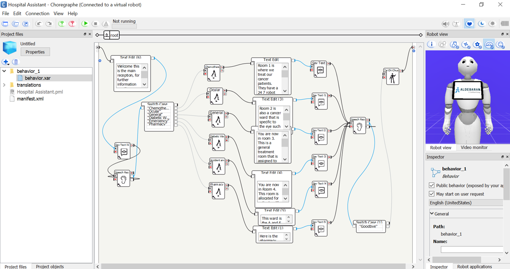
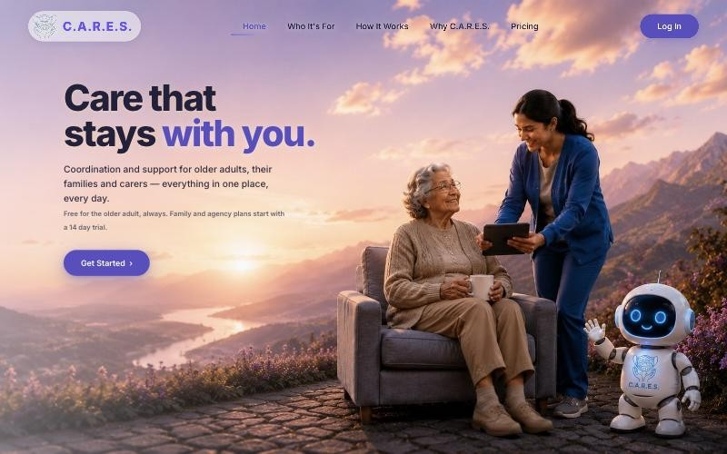

# Hi, I'm Mustafa

Robotics engineer with a First-Class Honours BEng in Robotics Engineering from the University of Essex. I design complete robotic systems end to end: mechanical design in SolidWorks, electronics and embedded control on Arduino and mbed, and autonomy in ROS2 with C++ and Python. My work covers both physical robot builds and simulation, tested on real hardware wherever I had it.

## Projects

- [Hybrid-Controlled Seed-Dispensing Robot](https://github.com/MustafaKhodir/seed-robot): a TurtleBot3 that drives itself, avoids obstacles with a laser scanner, and drops seeds from a 3D printed pot every two seconds using an Arduino, a servo and an IMU driven set of status lights.

  

- [Autonomous delivery vehicle](https://github.com/MustafaKhodir/autonomous-delivery-vehicle): a proof of concept for a sensor based car that carries medication and snacks to elderly people, with a 3D printed holder. I led the team as Scrum project manager, and designed the 3D printed parts and mounts, the electronics and wiring, and the software architecture, using AutoCAD and SolidWorks. I also wrote the motion code.

  

- [DoBot robotic arm](https://github.com/MustafaKhodir/dobot-robotic-arm): forward kinematics, inverse kinematics and trajectory planning in MATLAB for a DoBot Magician arm, plus a Python script that stacks 3D printed pieces with the suction cup.

  

- [Pepper humanoid robot interface](https://github.com/MustafaKhodir/pepper-hospital-assistant): a team project where we set up a SoftBank Pepper as a hospital assistant that listens for a ward name, gives information about it and guides the visitor there, built in Choregraphe. I led the team, designed the user interface and the logo, ran the project in Jira, worked on part of the Choregraphe programming and led the final presentation.

  

- [ROS2 mobile robotics](https://github.com/MustafaKhodir/ros2-mobile-robotics): TurtleBot square path from odometry, laser scanner navigation with SLAM maps, a C++ odometry simulation, and landmark based navigation to a charging station in ROS2 C++.

  

- [Embedded C on mbed](https://github.com/MustafaKhodir/embedded-c-mbed): a guessing game on an mbed board with keypad, LCD and LED bar talking to a PC over serial, and a keyword counter that scans a text file in one pass.

  

- [Virtual Cafe](https://github.com/MustafaKhodir/virtual-cafe-java): a multi client Java server where a Barista brews orders for many Customers at once, talking JSON over TCP.

  

- [Genetic algorithms in Python](https://github.com/MustafaKhodir/genetic-algorithms-python): my own steady state GA used on ASCII art, a binary optimisation demo and a digit riddle, plus symbolic regression with genetic programming on DEAP.

  

- [Smaller projects](https://github.com/MustafaKhodir/other-projects): a five in a row minimax player, a polygon drawing app, a world cities app, a binary search tree of prime ministers, C programs and MATLAB maths and control scripts.

  

- [C.A.R.E.S.](https://heycares.com): the company I founded. A platform that helps older adults live independently, with medication and appointment reminders, an SOS alert to their care circle, and a caregiver portal.

  

## Skills and tools

- Robotics: ROS2, TurtleBot3, SLAM with Cartographer and RViz, Gazebo simulation, PID control, odometry, laser scanners
- Hardware: Arduino Uno, servo motors, MPU6050 IMU, LEDs and breadboard circuits, mbed, TinkerCAD circuit simulation, Multisim
- Languages: Python, C++, C, Java, MATLAB
- CAD and making: TinkerCAD, SolidWorks, AutoCAD, 3D printing
- Web: HTML, JavaScript, Node.js, Express, PostgreSQL
- Ways of working: Agile sprints, Jira, GitLab, GitHub

## Contact

- Email: [mkhodir77@gmail.com](mailto:mkhodir77@gmail.com)
- LinkedIn: [linkedin.com/in/mustafakhodir](https://www.linkedin.com/in/mustafakhodir)
